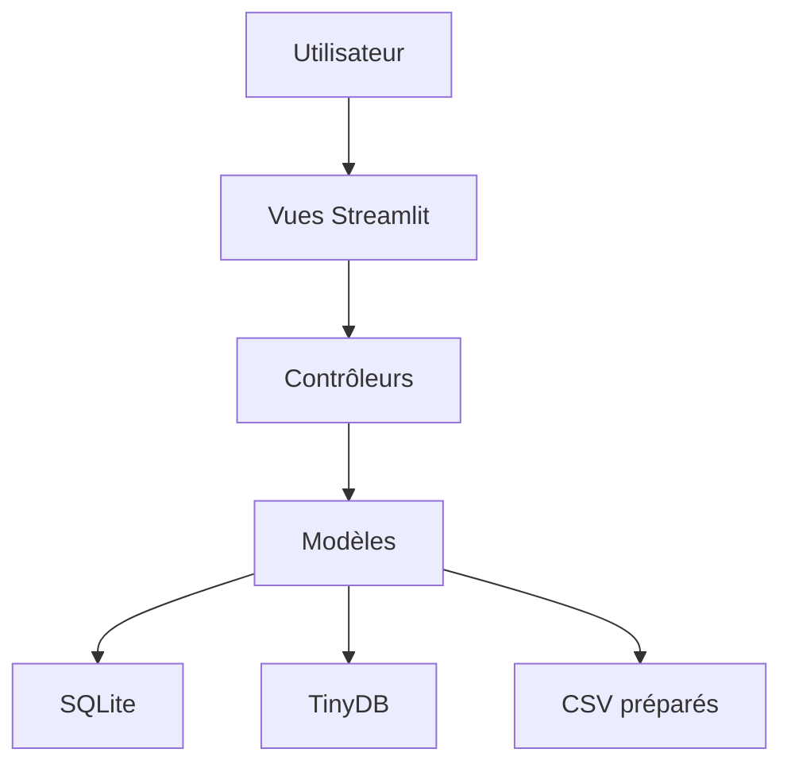
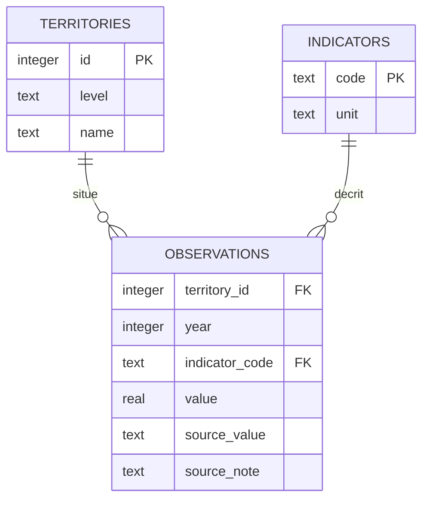

# Conception de l’application

## Besoin et périmètre

Permettre à un utilisateur d’explorer des indicateurs périnataux agrégés, de comparer les territoires et les années, puis de retrouver ou exporter une sélection. Les publics visés sont les personnes qui étudient ces indicateurs, notamment les professionnels et étudiants en santé. Il s’agit d’un cadrage de conception ; aucun entretien utilisateur n’a été réalisé dans cette révision.

| Besoin | Fonction | Critère d’acceptation |
|---|---|---|
| Explorer une évolution | Filtre de période et d’indicateur | Les années du tableau correspondent à la période choisie |
| Comparer des régions | Classement SQL | Ordre décroissant, limite respectée et valeurs manquantes exclues |
| Exporter | CSV/ZIP | Un utilisateur non connecté ne reçoit pas de bouton actif |
| Reprendre une analyse | Configurations personnelles | Les paramètres sont persistants et propres au compte |
| Gérer une sélection | Renommage et suppression | Un autre compte ne peut pas modifier le document |
| Reproduire l’installation | Environnement Python fixé | Les commandes documentées installent et lancent l’application |

## Architecture

Streamlit exécute l’interface et les traitements Python côté serveur. L’architecture logique est organisée en couches ; elle ne repose pas sur des services front-end et back-end indépendants. Les fonctions de transformation historiques restent en partie dans les vues : une extraction vers des services métier serait une évolution possible, pas une séparation déjà achevée.

## Modèle relationnel des indicateurs

La clé primaire d’observations est composée de territory_id, year et indicator_code. Le couple level/name identifie un territoire. Les contraintes empêchent les doublons d’observation, les années hors périmètre et les valeurs négatives. Les clés étrangères sont contrôlées à la construction. L’index year/indicator_code facilite les sélections annuelles.

Les trois tables historiques mortinatalite_france, mortinatalite_regions et mortinatalite_drom sont conservées pour alimenter les vues existantes. Les classements et statistiques SQL utilisent les tables normalisées. Les tables normalisées contiennent uniquement les données de mortinatalité et les effectifs associés ; les naissances restent chargées depuis les CSV.

users.db est séparée : users(uid, email UNIQUE, password), logs(id, uid, action, value), auth_attempts(email PRIMARY KEY, attempts, window_start). logs.uid référence users.uid. La table auth_attempts autorise les adresses de comptes inexistants pour limiter également ces tentatives.

## Modèle documentaire

Un document TinyDB contient id (UUID), owner (adresse du compte), name, created_at et parameters {year, indicator, limit}. Le contrôleur prend owner dans la session, jamais dans un champ du formulaire. Toutes les recherches et mutations incluent le propriétaire. Les écritures sont protégées par un verrou de fichier et un remplacement atomique. Le contexte visé est une installation sur un seul hôte, avec stockage local fiable ; cette solution ne constitue pas un cluster NoSQL.

## Parcours et interface

L’accueil mène aux pages Données, Naissances, Mortinatalité, Analyse et Conclusion. Connexion / Inscription mène au retour à la page d’origine. Mes analyses enregistrées est accessible depuis la barre latérale. Un utilisateur connecté peut y créer une configuration, consulter son classement et renommer ou supprimer la configuration. La suppression exige une confirmation visible.

Les champs possèdent des libellés et les tableaux complètent les graphiques. Une vérification manuelle au clavier, sur petit écran et avec un lecteur d’écran reste nécessaire ; aucune conformité RGAA n’est revendiquée. Les captures des pages réelles après correction peuvent documenter l’interface finale, sans les présenter comme des maquettes réalisées avant le développement.

## Données annotées

Trois cellules CSV comportent des notes : 4163*, 2,9** et 2,4**. La lecture retire uniquement les astérisques finaux et remplace la virgule décimale pour le calcul. La base normalisée conserve source_value et source_note. Aucune interprétation de la note n’est inventée : sa signification reste à vérifier dans les sources. Aucune valeur manquante n’est imputée.
